<!-- Self-Hosted Animated Header -->

  

  <em>Problem-first engineering. Reliable systems. Measurable impact.</em>

<!-- Socials -->

  
  
  

---

<h2 align="center">About Me</h2>

  <em>Systems-driven software engineer building reliable business platforms, resilient APIs, and production digital products.</em>

| Architecture & Systems | Production Reliability | Agentic AI Engineering |
|:---|:---|:---|
| • Clear abstractions & domain modeling • Scalable modular architectures • Deliberate engineering tradeoffs | • Concurrency locking & transactional integrity • Measured latency budgets (sub-24ms p95) • Automated testing & resilient recovery | • Deep reasoning & strategic architecture • Rapid prototyping with validation • Accelerated delivery with strong judgment |

---

<h2 align="center">What I Do</h2>

I design and build custom software that transforms complex ideas, business processes, and operational challenges into reliable digital systems.

| Area | What I Build | Business Impact |
|:-----|:-------------|:----------------|
| **Custom Business Software** | Workflow systems, internal tools, approval platforms, and management dashboards | Replaces inefficient manual processes and improves operational visibility |
| **Web & Mobile Applications** | Customer portals, SaaS products, marketplaces, and mobile-first platforms | Turns ideas into accessible, production-ready digital products |
| **Automation & Integrations** | Reporting automation, notifications, payment integrations, APIs, and data synchronization | Reduces repetitive work, errors, and disconnected processes |
| **Scalable Product Engineering** | Secure backends, role-based systems, optimized databases, and analytics platforms | Creates reliable software designed to grow with the organization |

> *I focus on understanding the real problem first, then building the simplest reliable system that delivers measurable value.*

---

<h2 align="center">Now Building</h2>

### Rental Management System - PropertyTech SaaS Platform

Building a multi-tenant rental management platform that helps landlords, caretakers, tenants, and platform administrators manage properties, rent payments, maintenance, and financial operations.

> **Active Sprint Focus:** Production hardening · Automated M-Pesa reconciliation · Background BullMQ workers · End-to-end operational monitoring

---

<h2 align="center">Open To</h2>

- **Full-time and graduate engineering opportunities** where I can contribute across backend, full-stack, custom software, and product engineering.
- **Freelance projects** helping businesses transform operational challenges and product ideas into reliable digital systems.
- **Early-stage startup opportunities**, including employment, contract work, technical partnerships, and co-founder conversations.
- **Remote, hybrid, and onsite opportunities** within Kenya and internationally.

> *I bring a problem-first mindset, adapt quickly to unfamiliar domains, and take ownership from system design through production delivery.*

---

<h2 align="center">Engineering Philosophy</h2>

| Principle | How I Apply It |
|:----------|:---------------|
| **Understand before building** | I define the real problem, constraints, and desired outcomes before choosing a solution. |
| **Simple systems scale better** | I prefer clear architectures and focused abstractions over unnecessary complexity. |
| **Build for reliability** | I treat security, correctness, observability, and failure handling as core product requirements. |
| **Optimize with evidence** | I use measurements and real usage patterns to guide performance and scaling decisions. |
| **Design for change** | I build maintainable systems that can evolve as business needs and user expectations change. |
| **AI strengthens engineering judgment** | I use AI to challenge assumptions, explore alternatives, and accelerate delivery without outsourcing decisions. |

> *The goal is not merely to ship software, but to build the right system and keep it valuable over time.*

---

<h2 align="center">Tech Stack</h2>

<table>
  <tr>
    <td width="50%" valign="top">
      <h4>Backend & Distributed Systems</h4>
      
    </td>
    <td width="50%" valign="top">
      <h4>Frontend & Mobile</h4>
      
    </td>
  </tr>
  <tr>
    <td width="50%" valign="top">
      <h4>Databases & Caching</h4>
      
    </td>
    <td width="50%" valign="top">
      <h4>DevOps, Cloud & Testing</h4>
      
    </td>
  </tr>
</table>

---

<h2 align="center">Featured Projects</h2>

### Rental Management System - PropertyTech SaaS Platform

A multi-tenant rental management platform designed for the African property market, connecting landlords, caretakers, tenants, and platform administrators through role-specific workflows.

- Engineered reliable M-Pesa payment reconciliation using idempotent callbacks, serializable database transactions, PostgreSQL advisory locks, and missed-callback recovery.
- Built four independently deployable role-based applications covering property operations, tenant payments, instalment plans, maintenance requests, analytics, and reporting.
- Moved PDF and Excel report generation into asynchronous BullMQ workers while securing the platform with RS256 authentication, refresh-token rotation, RBAC, rate limiting, and audit logs.
- Maintains **263 passing backend tests across 67 suites**, covering authentication, authorization, payments, rate limiting, and role-specific APIs.

**Built with:** React · TypeScript · Node.js · Express · PostgreSQL · Prisma · Redis · BullMQ · M-Pesa Daraja API

#### Role Workflows & Interactive Demos

| Role | Operational Scope | Interactive Video Walkthrough |
|:---|:---|:---:|
|  **Admin Portal** | System overview, multi-property oversight, audit trails, and platform configurations | [**Watch Admin Demo →**](https://drive.google.com/file/d/1fskJSbQ9XA6Mpbzn7TlM145S015qdGsG/view?usp=drive_link)  |
|  **Landlord Portal** | Rental income dashboards, unit allocations, expense tracking, and financial statements | [**Watch Landlord Demo →**](https://drive.google.com/file/d/1fypTiD6LowzUKntncmBzoWhdfKU_kG4c/view?usp=drive_link)  |
|  **Tenant Portal** | Rent payments via M-Pesa, instalment plans, payment history, and maintenance requests | [**Watch Tenant Demo →**](https://drive.google.com/file/d/1hU3etQncAG2cUebQtONILXqNYKXO-RQn/view?usp=drive_link)  |
|  **Caretaker Portal** | Unit inspection logs, tenant check-ins, maintenance dispatch, and meter readings | [**Watch Caretaker Demo →**](https://drive.google.com/file/d/1jXYEYVjkSEw1VPV8YbtpNECEh1MASsif/view?usp=drive_link)  |

### WhatsApp Product Verification - Anti-Counterfeiting Platform

A secure verification platform that helps brands and consumers identify counterfeit products through WhatsApp.

- Achieved **sub-24ms p95 response times** with zero failed requests during load testing at 200 concurrent users.
- Prevented duplicate activations and race-condition fraud using PostgreSQL row-level locking with complete audit trails.
- Secured verification workflows using HMAC-SHA256 webhook validation, role-based access control, and dual-layer rate limiting.

**Built with:** Node.js · TypeScript · PostgreSQL · React · Meta WhatsApp Cloud API

  

### TaskFlow - Project Management Platform

A project management platform for organizing team workflows, tracking progress, and managing tasks through interactive Kanban boards.

- Engineered for **sub-50ms API response times** while handling boards with more than 1,000 tasks.
- Reduced database round-trips by **60%** using MongoDB aggregation pipelines and eliminated N+1 query patterns.
- Combined tiered Redis caching, targeted cache invalidation, and selective projections to reduce payload sizes by **70%**.

**Built with:** Next.js · TypeScript · MongoDB · Redis · React Query

  

### AI-Powered Fitness & Wellness Platform

A health tracking platform that combines workout, nutrition, and mental wellness data to deliver personalized recommendations.

- Built three confidence-scored Random Forest models trained on more than **30,000 synthetic samples**, with rule-based fallbacks for uncertain predictions.
- Reduced recommendation latency by approximately **350ms** by batching and parallelizing three recommendation streams.
- Integrated Google Fit and Fitbit data with automatic OAuth token refresh, real-time activity feeds, and personalized trend analysis.

**Built with:** React · Node.js · Express · MongoDB · Python Flask · scikit-learn · Socket.IO

  

---

<h2 align="center">GitHub Stats</h2>

  
  

---

<h2 align="center">Credibility</h2>

| Area | Evidence |
|:-----|:---------|
| **Professional Experience** | Delivered two confidential client systems that are currently in use, translating business requirements into reliable production software. |
| **Technical Validation** | Built a multi-tenant PropertyTech platform backed by 263 passing tests across 67 suites, alongside an anti-counterfeiting platform validated at sub-24ms p95 during load testing. |
| **Security & Reliability** | Implemented JWT authentication, HMAC-SHA256 webhook validation, PostgreSQL row-level locking, rate limiting, and audit logging. |
| **Education** | BSc. Computer Science, Chuka University, 2025. |
| **Certifications** | Docker Bootcamp for ML, GenAI and Agentic AI by Udemy · Prompt Engineering with Amazon Q Developer by AWS · Cybersecurity & Emerging Technologies Awareness by ICT Authority, Kenya |

---

<h2 align="center">Beyond Code</h2>

- I support fellow developers through practical advice, knowledge sharing, and occasional mentorship.
- I value empathy, transparency, openness, and emotional intelligence when collaborating with others.
- I care about consumer safety and building tools that help businesses operate more effectively.
- Outside engineering, I enjoy video games, music, nature walks, films, and series.

---

<h2 align="center">Let's Connect &amp; Collaborate</h2>

  Always open to conversations with curious builders, creative minds, and product teams.

  
  
  

<!-- Self-Hosted Animated Footer Bracket -->

  

